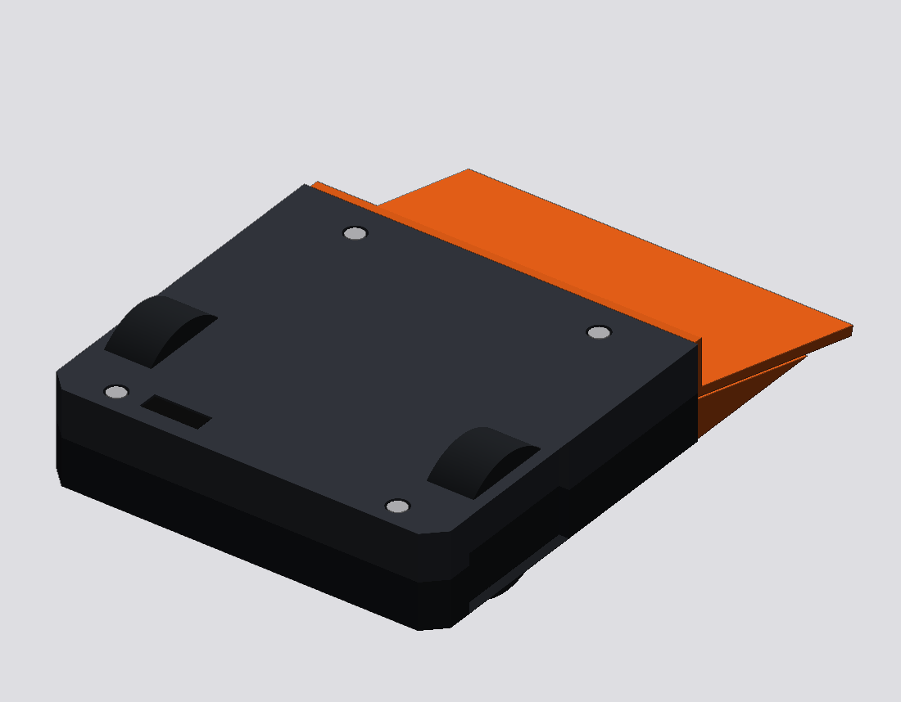
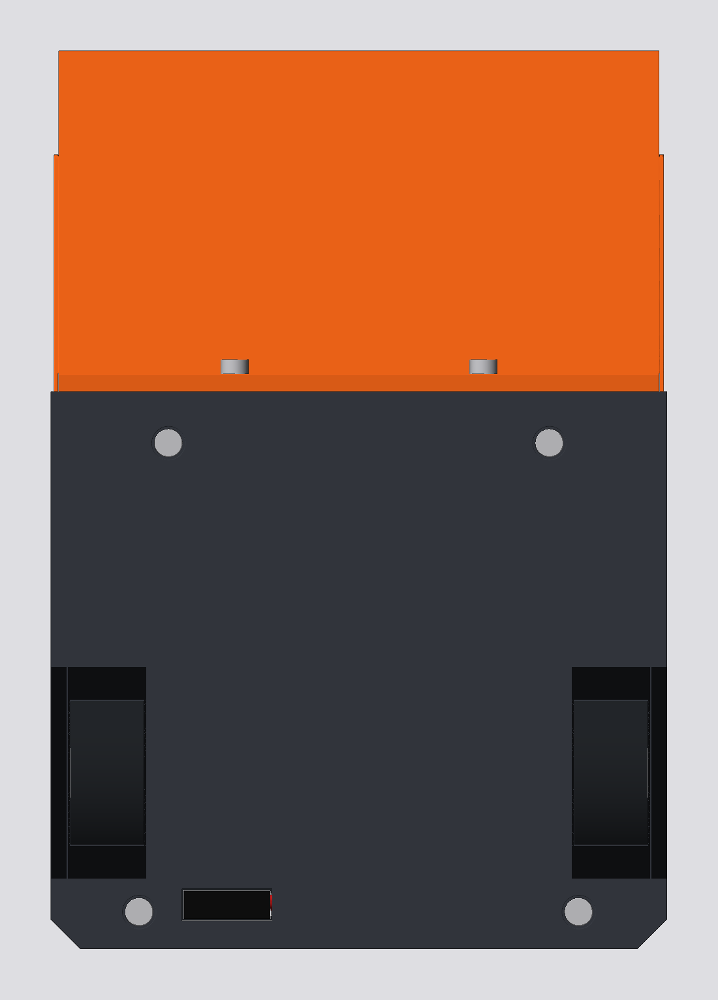
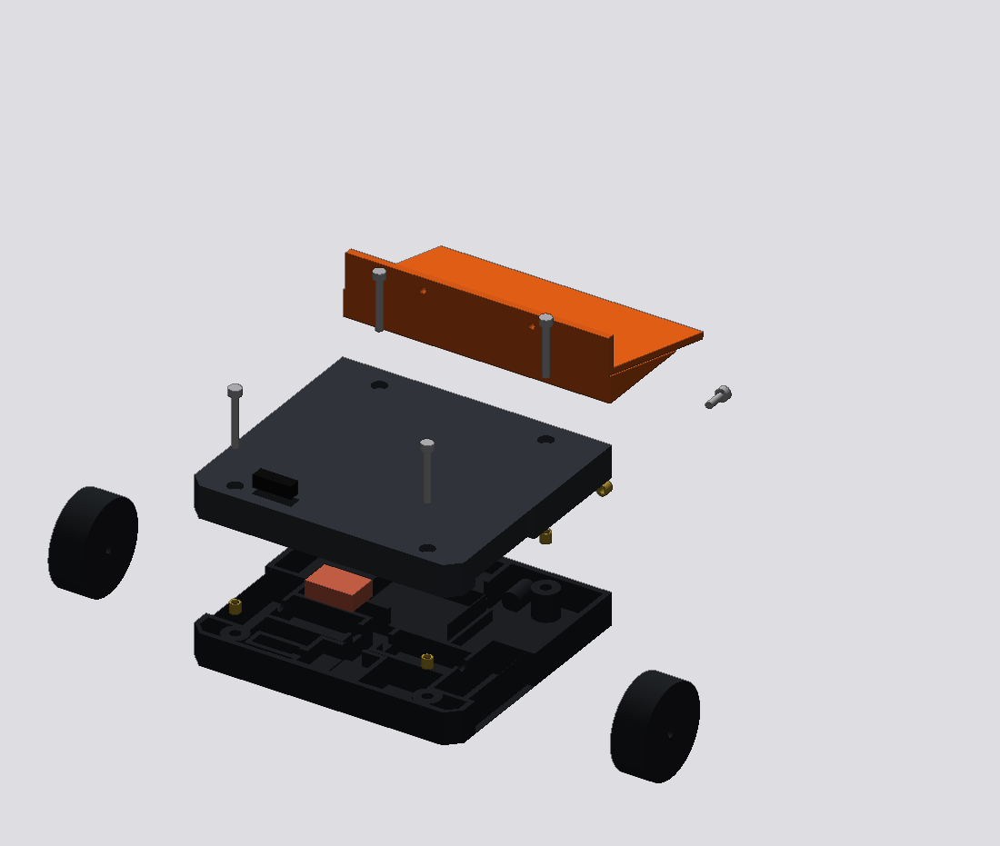
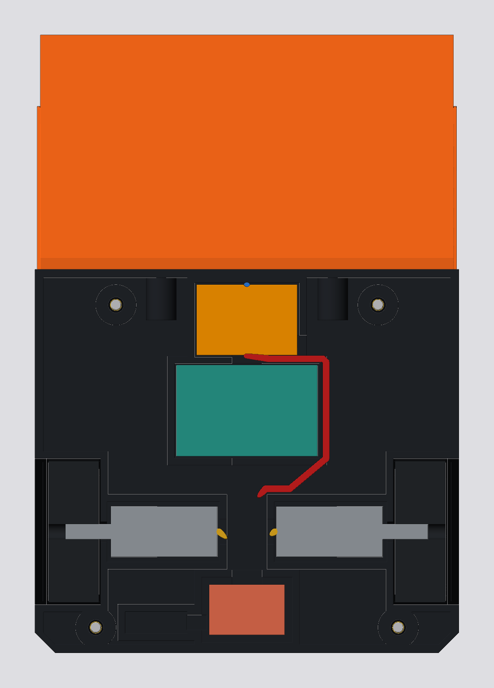

# Reference 2WD wedge

Verifier (`aws2025`): passes. 0 blockers, 0 warnings, 14 checks passed.

Mass 106.0 g (range 87.0 to 125.1 g).

| Top | Exploded | Section |
|---|---|---|
|  |  |  |

## Files

- `spec.json`: the full editable design (shapes, parts, fasteners, wires, connections). Load it back with the robot tools to change and re-verify.
- `report.json`, `REPORT.md`: verifier output.
- `stl/`: one STL per part (mm, all in the robot start pose so they assemble when imported together, wires included).
- `renders/`: iso, top, back, exploded and section views.

Regenerate: `cargo run --release -p cadcraft-robot --example export -- wedge_2wd robots`

